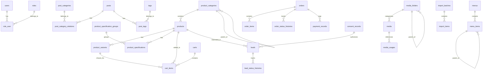

# Entity-Relationship Diagram (ERD) — VinFast Hải Phòng

## Sơ đồ quan hệ tổng quan

## Các quan hệ chính
1. **Catalog:**
   - `product_categories` 1 - N `products`
   - `products` 1 - N `product_variants`
   - `products` 1 - N `product_specifications`
   - `product_specification_groups` 1 - N `product_specifications`
2. **Media:**
   - `media` 1 - N `media_usages` (quan hệ đa hình polymorphic theo `usable_type` và `usable_id`)
   - `media_folders` 1 - N `media`
3. **Content & Blog:**
   - `posts` N - N `post_categories` (qua `post_category_relations`)
   - `posts` N - N `tags` (qua `post_tags`)
4. **Commerce:**
   - `orders` 1 - N `order_items` (snapshot tên, giá, phiên bản tại thời điểm đặt hàng)
   - `orders` 1 - N `order_status_histories`
   - `orders` 1 - N `payment_records` (chỉ ghi nhận dòng tiền mặt trực tiếp)
5. **CRM & Leads:**
   - `leads` N - 1 `products`
   - `leads` N - 1 `consent_records`
   - `leads` 1 - N `lead_status_histories`

